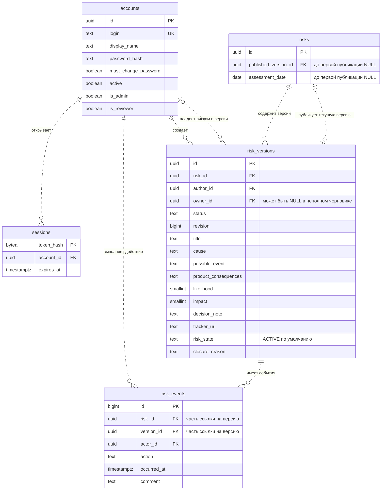

# Технический дизайн пилота

## Context

Правила и примеры уже есть в автономном HTML. Java 25 и Next.js пока служат каркасами. HTML остаётся отдельной демонстрацией. Серверная реализация переносит согласованное поведение с уточнениями из [дельты реестра](specs/risk-register/spec.md).

## Goals / Non-Goals

**Цель** — односерверный стенд с постоянными данными, серверной проверкой доступа и обслуживанием одним ответственным. Границы пилота описаны в [предложении](proposal.md).

## Decisions

- **Приложение.** Next.js обслуживает страницы. Бэкенд — один проект Java 25 и Spring Boot с Gradle Wrapper. При реализации заменить Maven-каркас и обновить инструкции сборки. Доступ к PostgreSQL идёт через Spring JDBC и явный SQL. Liquibase применяет миграции из ресурсов бэкенда при запуске приложения.
- **Границы модулей.** `accounts` владеет аккаунтами, ролями и сессиями. `risks` владеет карточками, версиями, ревью, оценками и историей. `risks` получает проверенные данные участника и сведения о доступности владельца через публичный интерфейс `accounts`. Обратной зависимости нет. Контроллеры переводят HTTP-запросы в операции модулей. Архитектурный тест проверяет направление зависимости и запрещает обращения к внутренним классам соседнего модуля.
- **Вход.** REST API предоставляет вход, выход, смену пароля и текущий профиль. Приложение хранит адаптивные хеши паролей и применяет серверные сессии, cookies с Secure, HttpOnly и SameSite, CSRF-защиту и ограничение попыток входа. После смены роли, сброса или отключения старые сессии отзываются. Первого администратора создаёт одноразовая команда оператора. Проверка последнего активного администратора защищена от конкурирующих действий.
- **Реестр и права.** API предоставляет чтение таблиц, карточки и истории, действия над предложениями и подтверждение оценки. Отдельные операции администрирования доступны только администраторам. Сервер использует участника из сессии и возвращает только разрешённые данные. Содержимое приватной правки исключается из ответов, журналов и истории публикации. Для снятия блокировки ревьюеру доступны идентификатор правки и имя автора.
- **Запуск.** Docker Compose объединяет Next.js, API и PostgreSQL с постоянным томом. Один HTTPS-адрес публикует интерфейс и API через обратный прокси, БД доступна внутри сети Compose. Оператор предоставляет внутренний адрес и TLS-сертификат. Секреты передаются вне репозитория.

## Схема PostgreSQL

### ER-диаграмма

### Ключи и ограничения

- `accounts.login` уникален. Роли администратора и ревьюера хранятся двумя независимыми флагами. Отключение меняет `active` и отзывает сессии. Запись аккаунта сохраняется для ссылок на авторов, владельцев и исполнителей. В `sessions` хранится хеш непрозрачного токена из cookie и срок действия. Для отзыва удаляются соответствующие строки сессий.
- Риск и его первый черновик создаются в одной транзакции. `risks.published_version_id` и `risks.assessment_date` либо оба пусты, либо оба заданы. Записи без публикации доступны через представления предложений по правилам доступа. Активный реестр и архив определяются по `risk_state` опубликованной версии со значениями `ACTIVE`, `REMOVED` и `MATERIALIZED`.
- У `risk_versions` глобальный ID и ограничение `UNIQUE (risk_id, id)`. Составные внешние ключи `risks (id, published_version_id)` и `risk_events (risk_id, version_id)` ссылаются на `risk_versions (risk_id, id)`. Они исключают связь с версией другого риска. Транзакция публикации проверяет, что указатель переводится на утверждённую версию.
- `risk_versions.status` принимает значения `DRAFT`, `IN_REVIEW`, `RETURNED`, `APPROVED`, `WITHDRAWN` и `CLOSED`. Частичный уникальный индекс по `risk_id` охватывает первые три состояния и разрешает одну незавершённую версию. `revision` начинается с 1 и увеличивается при изменении полей или состояния этой версии. Приложение изменяет поля только в черновике и после возврата. Утверждённую версию сохраняет как неизменяемый снимок.
- Незаполненные поля карточки в черновике допускают `NULL`. Вероятность и влияние при наличии ограничены диапазоном 1–10. При отправке сервер проверяет полноту обязательных полей по спецификации, при одобрении завершения требует причину. Балл, категория, отметка о критических последствиях и срок пересмотра вычисляются из оценок и даты оценки.
- `risk_events.action` принимает значения `SUBMIT`, `RETURN`, `APPROVE`, `WITHDRAW`, `UNBLOCK` и `CONFIRM_ASSESSMENT`. Событие добавляется в транзакции действия и хранит исполнителя, время и пояснение, если оно есть. Факт отправки позволяет применить правила видимости после отзыва. Общая история включает утверждённые снимки и события утверждения и подтверждения оценки. События предложений доступны по правилам предложений. Поля приватных карточек хранятся в версии.

## HTTP-интерфейс

Общий контракт фронтенда и бэкенда хранится в `api/openapi.yml` в корне репозитория. До реализации HTTP-задач описать в нём маршруты, параметры, схемы запросов и ответов, права, сессии, CSRF и примеры ошибок. Для каждой задачи, меняющей HTTP-поведение, сначала обновить контракт, затем код обеих сторон. При неизменном API достаточно сверки с контрактом. CI проверяет файл, а контрактные тесты сверяют ответы с его схемами. Клиент Next.js пишется вручную.

Все пути имеют префикс `/api`. Сервер определяет участника по сессии и проверяет права для каждого запроса.

| Назначение | Эндпоинты |
| --- | --- |
| Сессия и профиль | `GET /csrf`, `POST /session`, `DELETE /session`, `GET /me`, `POST /me/password`. |
| Администрирование | `GET /admin/accounts`, `POST /admin/accounts`, `PATCH /admin/accounts/{id}` для ролей и активности, `POST /admin/accounts/{id}/reset-password`. |
| Выбор владельца | `GET /participants` возвращает ID и имена активных участников. |
| Реестр и история | `GET /risks?view=active` и `GET /risks?view=archive` с поиском и фильтрами, `GET /risks/{id}` для опубликованной карточки, `GET /risks/{id}/history` для доступной участнику истории. |
| Создание и правки | `POST /risks` создаёт риск и его первый черновик. `POST /risks/{id}/draft` открывает правку опубликованной версии. `GET /risks/{id}/draft` читает версию согласно её статусу и правам. `PATCH /risks/{id}/draft` сохраняет изменения автора в черновой или возвращённой версии. |
| Предложения и ревью | `GET /risks?view=mine` и `GET /risks?view=review` возвращают версии по правам. `POST /risks/{id}/draft/{action}` принимает `submit`, `return`, `approve`, `withdraw` или `unblock`. |
| Подтверждение оценки | `POST /risks/{id}/assessment/confirm` принимает ID ожидаемого опубликованного снимка. Открытая правка этому действию не мешает. |

Сохранение и команды над версией передают её ID и ожидаемый номер изменения. Открытие правки указывает ожидаемый опубликованный снимок. Для возврата и разблокировки требуется пояснение. Устаревшее действие или попытка создать вторую правку возвращает `409 Conflict`. Интерфейс предлагает обновить карточку. Запрос содержимого чужого приватного черновика возвращает `404`. Ревьюер получает необходимые для разблокировки метаданные в опубликованной карточке: ID и номер изменения версии, факт правки и имя автора. Текст черновика в этот ответ не входит.

`withdraw` доступен автору как для первого предложения, так и для правки, включая версию на ревью. `unblock` позволяет ревьюеру закрыть первое отправленное или возвращённое предложение с пояснением. Первый приватный черновик этим действием недоступен. Закрытые первые предложения исключаются из активной очереди, а результат доступен в личной истории автора. Для отозванного предложения результат также доступен ревьюерам, которым оно было доступно до отзыва. Повторная подача начинается через `POST /risks` с новым ID.

## Транзакции и даты оценки

- При утверждении в одной транзакции проверить права, состояние и номер версии, утвердить снимок, переключить указатель риска и записать событие. Первая публикация устанавливает дату оценки. При переоценке дата обновляется. При правке текста, владельца или заметки сохраняется.
- В транзакции одобрения повторно проверить активность владельца для первой публикации или нового назначения. При отказе версия остаётся на ревью, ответ объясняет причину и позволяет ревьюеру вернуть её автору. Сохранение прежнего отключённого владельца не блокирует правку.
- Отзыв и утверждение проверяют одну и ту же ожидаемую версию и состояние. Первый сохранённый переход выигрывает, второй получает `409` без смены состояния и дополнительных событий. Изменение полей возможно только в черновике или после возврата.
- При подтверждении проверить под блокировкой строки риска, что ожидаемый снимок всё ещё опубликован. В той же транзакции обновить дату и добавить событие. Статус, содержимое и номер открытой правки сохраняются.
- Приоритет рассчитывает сервер. Срок пересмотра определяется прибавлением трёх календарных месяцев к дате оценки в настроенном часовом поясе команды, с переносом на последний день короткого месяца.

## Risks / Trade-offs

- Локальные учётные записи требуют ручной выдачи и восстановления. Ответственный заранее проверяет вход участников и выдаёт временные пароли лично.
- Один сервер может стать недоступен целиком. Ежедневная копия PostgreSQL выносится в защищённое хранилище вне сервера и сохраняется 14 дней. При восстановлении на предыдущую копию изменения после неё могут быть потеряны.

## Migration Plan

1. Подготовить внутренний доступ, TLS, секреты и целевое хранилище копий. Поднять Compose и выполнить миграции на пустой БД. Демонстрационные записи остаются в HTML.
2. Создать первого администратора и аккаунты пилота. Проверить готовность приложения и восстановление копии на отдельном стенде до встречи.
3. Перед обновлениями делать резервную копию. При сбое вернуть предыдущую версию приложения. Если схема несовместима, восстановить предобновленческую копию по инструкции оператора с учётом изменений после её создания.
4. После любого восстановления держать пользовательский доступ закрытым до окончания сверки. Удалить восстановленные сессии, привести активность аккаунтов и роли к актуальному списку пилота и повторить сбросы паролей, сделанные после копии. Затем открыть стенд и проверить, что требуется новый вход, а отключённые аккаунты не получают доступ.
